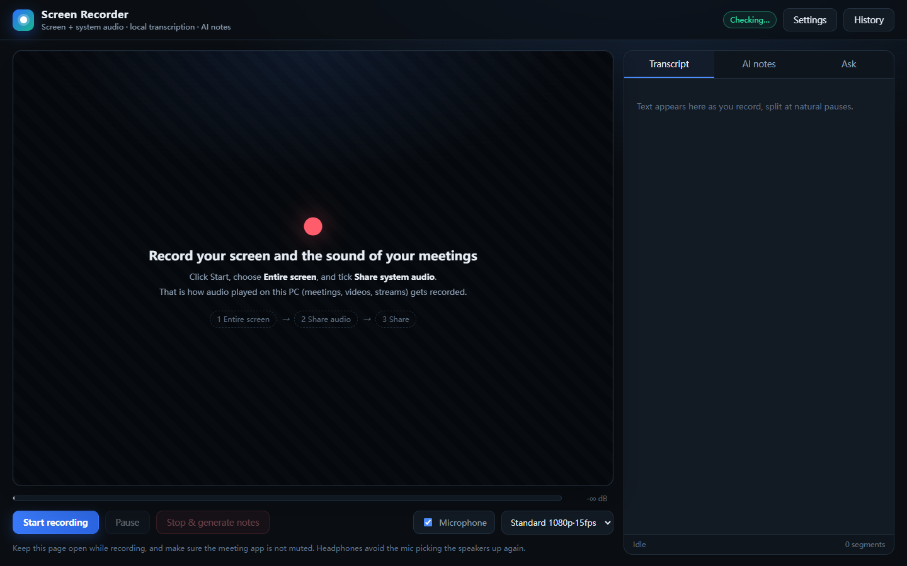
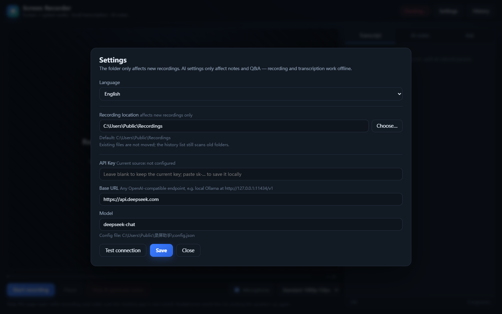

# Screen Recorder AI

**A local-first Windows screen recorder with system-audio capture, offline speech-to-text and AI meeting notes.**

English | [简体中文](README.zh-CN.md)



Records your screen together with whatever your PC is playing — online meetings, videos, livestreams — transcribes it locally in real time, and has an LLM write meeting notes while recording. You can ask the AI questions mid-recording. Audio and video never leave your machine; speech recognition is fully offline.

---

## Features

- **Screen + system audio together**: WASAPI loopback — no "Stereo Mix", no virtual audio driver
- **One click**: the desktop app starts recording the current screen immediately, with no share picker and no "share system audio" checkbox
- **Local real-time transcription**: SenseVoiceSmall + Silero VAD, CPU only, offline, sentence segmentation with timestamps
- **Live AI notes**: refreshed every ~30 s (overview / key points / decisions / action items / open questions)
- **Ask anytime**: answers are grounded in the transcript and cite timestamps
- **Cancel anytime**: discard a recording, or stop and save the video + transcript without running AI notes
- **Complete output**: `recording.mp4` (H.264/AAC, seekable) + `transcript.md` + `summary.md` + poster
- **History**: built-in list; regenerate notes for any recording
- **Two shapes**: Electron desktop app, or a local web UI
- **Bilingual UI**: English / 简体中文, switchable in Settings — AI notes and Q&A follow the UI language

---

## Why most screen recorders miss system audio

Windows offers three different ways to capture audio:

| Path | What you get | Typical failure |
|---|---|---|
| Recording device (microphone) | Room audio from a physical mic | Cannot capture what the PC is playing |
| Stereo Mix | A virtual input device exposed by the audio driver | Realtek / Intel / Bluetooth drivers often do not expose it |
| **WASAPI loopback** | The audio stream the system is currently rendering | No Stereo Mix needed; this is what OBS's "Desktop Audio" uses |

This project takes the third path: the Electron main process returns the screen plus `audio: 'loopback'` from `setDisplayMediaRequestHandler`, so there is nothing to tick, and it never silently falls back to the microphone.

> DRM-protected content (Netflix, etc.) is blocked by Windows itself and cannot be captured.

---

## Requirements

- Windows 10 / 11 (x64)
- Node.js 20+ (build/development only — the packaged app bundles its own runtime)
- ~1 GB of disk for source + dependencies (228 MB speech model, 110 MB ffmpeg, Electron)

---

## Quick start

```bat
git clone https://github.com/zhaopw5/screen-recorder.git
cd screen-recorder

npm install
powershell -ExecutionPolicy Bypass -File setup.ps1
```

`setup.ps1` prepares the two things that are not committed to the repository:

- `models/` — SenseVoiceSmall int8 + Silero VAD (~228 MB). It first tries the HuggingFace mirror, and reuses an existing DeepSeek Harness cache if present.
- `bin/ffmpeg.exe` (~110 MB, optional; only used to write WebM duration and extract posters)

Then either:

```bat
npm run app      :: run the desktop app in development
npm run build    :: package and install into dist\ScreenRecorder in this repo
```

> Electron crashes immediately when launched from a path containing non-ASCII characters, so `build-app.ps1` installs to an ASCII-only directory. Do not move the installed app into a Chinese-named folder.

### Browser mode

```bat
npm start
```

Open `http://127.0.0.1:8787`, choose **Entire screen**, and tick **Share system audio**. Same features, one extra manual step.

---

## Usage

1. Launch **Screen Recorder AI** from the desktop shortcut
2. Click **Start recording**
3. When the meeting is over, click **Stop & generate notes** and wait 10–60 s

Three panels on the right:

| Panel | What it does |
|---|---|
| Live transcript | Sentence-level segments with timestamps, ~1–3 s latency |
| AI notes | Refreshed roughly every 30 s |
| Ask | e.g. "What was the budget?" / "Summarize the last ten minutes" |

Output goes to `C:\Users\<you>\Videos\录屏助手\<timestamp>\` by default:

```
recording.mp4    video
poster.jpg       cover image
transcript.md    timestamped transcript
summary.md       meeting notes
meta.json        metadata
```

Headphones are recommended: with speakers, the microphone picks up the audio again and the transcript gets duplicated.

---

## Configuration

### Recording location

**Settings → Recording location**: type a path or click **Choose…** to pick a folder.

- Applies to **new recordings only**; existing files are not moved
- The history list still scans old directories, so nothing disappears
- Default: `C:\Users\<you>\Videos\录屏助手`
- Stored as `recordingsDir` in `%APPDATA%\录屏助手\config.json`

### AI model

**Settings → API Key / Base URL / Model**, then **Test connection** before saving.



Any OpenAI-compatible endpoint works, including a local Ollama (`http://127.0.0.1:11434/v1`).

Environment variables take precedence:

```bat
set REC_API_KEY=sk-xxxx
set REC_BASE_URL=https://api.deepseek.com
set REC_MODEL=deepseek-chat
```

`OPENAI_API_KEY` / `OPENAI_BASE_URL` are intentionally **not** read — those are usually set by other tools and mixing them with a DeepSeek endpoint causes 401s.

Without a key, recording and local transcription still work; only AI notes and Q&A are disabled.

### Speech models

Lookup order: `SENSEVOICE_MODEL_DIR` → bundled `models/` → `~/.dsh/speech-to-text/sensevoice/models`.

---

## How it works

```
Electron window (bundled Chromium)
  │
  ├─ main process: setDisplayMediaRequestHandler
  │     desktopCapturer → screen under the window + audio:'loopback'   ← WASAPI loopback
  │
  └─ renderer: getDisplayMedia
        ├─ MediaRecorder (MP4 / H.264 + AAC) ── every 4 s ──▶ POST /api/session/:id/chunk
        └─ AudioWorklet 48 kHz → 16 kHz mono PCM ── every 1 s ──▶ POST /api/session/:id/audio
                                                                     │
                                                           child process: sherpa-onnx
                                                           Silero VAD → SenseVoice
                                                                     │
                                                           SSE /events → live transcript
                                                                     │
                                                     LLM (rolling notes / streaming Q&A)
```

- Frontend: plain JS + Web Audio + MediaRecorder, no framework, no build step
- Backend: Node's native `http`, no third-party runtime dependencies; `startServer()` is shared by the desktop and browser modes
- ASR: sherpa-onnx + SenseVoiceSmall int8 + Silero VAD, CPU only
- Post-processing: ffmpeg remux (fixes missing WebM duration) + poster extraction

---

## FAQ

| Symptom | Fix |
|---|---|
| Desktop app closes instantly | Check the install path for non-ASCII characters; re-run `npm run build` |
| Recording has no sound | Watch the level meter; check the output device and that the meeting app is not muted |
| Player shows 0:00 | ffmpeg fixes this automatically; without it, play in Chrome/Edge |
| AI returns 401 | Use **Test connection**; make sure the key and base URL belong to the same provider |
| Notes say "本地自动摘录" | That is the offline fallback; click **Regenerate notes** to retry |
| Port already in use | The server automatically tries 8788, 8789, … |

---

## Privacy

- Video, audio, transcripts and notes stay on your machine
- Speech recognition is fully offline
- Only the transcribed **text** is sent to the LLM endpoint you configure
- No telemetry

---

## Limitations

- One screen at a time (the display containing the app window)
- No speaker diarization
- Closing the window interrupts recording (chunks remain on disk but are not merged automatically)
- Windows only; macOS/Linux would need a different screen-audio path
- DRM-protected content cannot be captured

---

## Project layout

```
screen-recorder/
├── electron/main.cjs     # window, auto screen selection, loopback audio
├── server.mjs            # local HTTP + SSE server, sessions, AI orchestration
├── lib/                  # ASR wrapper, worker, LLM client
├── public/               # frontend (no build step)
├── vendor/               # sherpa-onnx runtime (Apache-2.0)
├── assets/icon.ico
├── setup.ps1             # download models / ffmpeg
├── build-app.ps1         # package and install
└── docs/
```

---

## Third-party components

See [THIRD_PARTY_NOTICES.md](THIRD_PARTY_NOTICES.md). Mainly sherpa-onnx (Apache-2.0), Silero VAD (MIT), FFmpeg (LGPL/GPL, downloaded at setup time) and the SenseVoice model (follow upstream terms).

This project is not affiliated with DeepSeek or DeepSeek Harness.

## License

[MIT](LICENSE)
