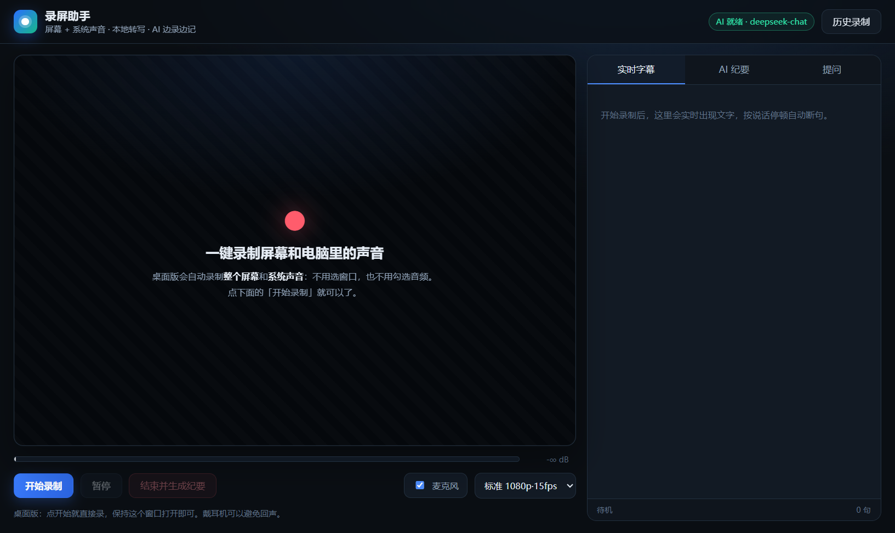
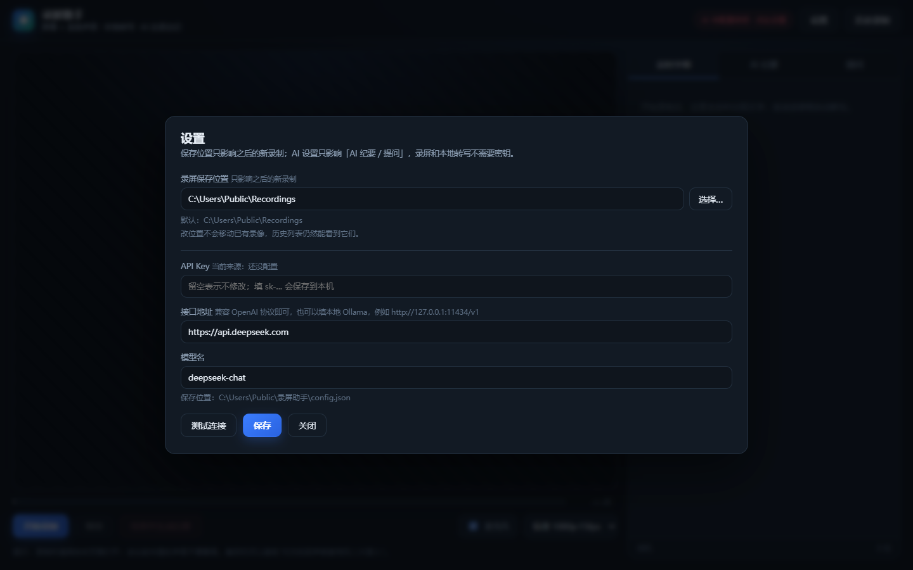

# 录屏助手 · Screen Recorder AI

**Windows 本地录屏 + 系统声音 + 离线语音转写 + AI 会议纪要。**

[English](README.md) | 简体中文



录屏的同时把电脑里正在播放的声音（线上会议、视频、直播）一起录下来，本地实时转成文字，并让大模型边录边写纪要；录制过程中可以随时向 AI 提问。音视频不出本机，语音识别完全离线。

---

## 功能

- **屏幕 + 系统声音一起录**：基于 WASAPI 环回，不需要「立体声混音」，也不需要装虚拟声卡
- **一键开始**：桌面版点一下就直接录「当前屏幕」，不弹系统分享框、不用勾选音频
- **本地实时转写**：SenseVoiceSmall + Silero VAD，纯 CPU、不联网，按停顿自动断句、带时间戳
- **AI 边录边写纪要**：约每 30 秒合并更新（概览 / 要点 / 结论 / 待办 / 待确认）
- **随时提问**：基于当前转写和纪要回答，带时间戳
- **产物齐全**：`recording.mp4`（H.264/AAC，可拖进度条）+ `transcript.md` + `summary.md` + 封面
- **历史记录**：内置列表，可回看、补生成纪要
- **两种形态**：Electron 桌面 App，或本地浏览器页面
- **中英双语界面**：设置里一键切换，AI 纪要 / 问答语言跟随界面语言

---

## 为什么很多录屏软件录不到「电脑里的声音」

Windows 采音频有三条路：

| 方式 | 拿到的是什么 | 常见问题 |
|---|---|---|
| 录音设备（麦克风） | 物理麦克风的环境声 | 录不到电脑播放的声音 |
| 立体声混音（Stereo Mix） | 声卡模拟的一个录音设备 | Realtek / Intel / 蓝牙耳机驱动经常默认不提供 |
| **WASAPI Loopback（环回）** | 系统当前正在播放的音频流 | 不依赖 Stereo Mix，OBS 的「桌面音频」用的就是它 |

本项目走第三条路：Electron 主进程通过 `setDisplayMediaRequestHandler` 直接返回「屏幕 + `audio: 'loopback'`」，因此既不用手动勾选，也不会退化成麦克风。

> 受 DRM 保护的内容（Netflix 等）系统层面就禁止采集，录不到属正常。

---

## 环境要求

- Windows 10 / 11（x64）
- Node.js 20+（仅构建 / 开发需要；打包后的 App 自带运行时）
- 磁盘：源码 + 依赖约 1 GB（含 228 MB 语音模型、110 MB ffmpeg、Electron）

---

## 快速开始

```bat
git clone https://github.com/zhaopw5/screen-recorder.git
cd screen-recorder

npm install
powershell -ExecutionPolicy Bypass -File setup.ps1
```

`setup.ps1` 会准备两样不进仓库的东西：

- `models/`：SenseVoiceSmall int8 + Silero VAD（约 228 MB，优先从 HuggingFace 镜像下载；如果你装过 DeepSeek Harness，会直接复用它的缓存）
- `bin/ffmpeg.exe`（约 110 MB，可选；只用于补时长和抽封面）

然后任选一种运行方式：

```bat
npm run app      :: 开发模式，直接开窗口
npm run build    :: 打包安装到 %LOCALAPPDATA%\Programs\ScreenRecorder，并创建桌面快捷方式
```

> 注意：Electron 在含中文的路径下会启动即崩溃，`build-app.ps1` 会固定安装到纯英文目录，请不要手动把 App 挪到中文路径。

### 浏览器模式（备用）

```bat
npm start
```

打开 `http://127.0.0.1:8787`，选择「整个屏幕」并勾选「同时分享系统音频」。功能与桌面版一致，只是多一步手动选择。

---

## 使用

1. 双击桌面「录屏助手」
2. 点 **开始录制**
3. 会议 / 视频结束后点 **结束并生成纪要**，等 10~60 秒

录制中右侧三个面板：

| 面板 | 作用 |
|---|---|
| 实时字幕 | 按停顿断句，延迟约 1~3 秒 |
| AI 纪要 | 每约 30 秒刷新一次 |
| 提问 | 「刚才说的预算是多少？」「总结一下前十分钟」 |

产物默认在 `C:\Users\<你>\Videos\录屏助手\<时间戳>\`：

```
recording.mp4    录像
poster.jpg       封面
transcript.md    逐字稿（带时间戳）
summary.md       会议纪要
meta.json        元数据
```

建议戴耳机：外放会被麦克风二次录入，转写出现重复。

---

## 配置

### 界面语言

设置 → **语言**，可选 **简体中文 / English**，切换后立即生效。

界面语言同时决定 AI 纪要、逐字稿和问答的输出语言：切成 English 后，生成的 `summary.md` / `transcript.md` 也是英文。

### 录屏保存位置

点右上角 **设置**，在「录屏保存位置」里直接输入路径，或点 **选择…** 挑一个文件夹（桌面版会弹系统文件夹选择框）。

- 只影响**之后的新录制**，已有录像不会被移动
- 改过位置后，历史列表仍然会扫描旧目录，旧录像不会消失
- 默认位置：`C:\Users\<你>\Videos\录屏助手`
- 对应 `%APPDATA%\录屏助手\config.json` 里的 `recordingsDir`（旧目录记录在 `recordingsDirs`）

### AI 模型

点右上角 **设置** 填 API Key / 接口地址 / 模型名，点 **测试连接** 验证后保存。接口只要是 OpenAI 兼容的即可，包括本地 Ollama（`http://127.0.0.1:11434/v1`）。

环境变量优先级更高：

```bat
set REC_API_KEY=sk-xxxx
set REC_BASE_URL=https://api.deepseek.com
set REC_MODEL=deepseek-chat
```

> 不会读取 `OPENAI_API_KEY` / `OPENAI_BASE_URL`——这两个变量常被其他软件占用，混用会导致 401。

没有配置密钥时，录屏和本地转写照常，只是没有 AI 纪要和问答。

### 语音模型位置

优先 `SENSEVOICE_MODEL_DIR` 环境变量 → 自带 `models/` → `~/.dsh/speech-to-text/sensevoice/models`。



---

## 工作原理

```
Electron 窗口（内置 Chromium）
  │
  ├─ 主进程 setDisplayMediaRequestHandler
  │     desktopCapturer 取窗口所在屏幕 + audio:'loopback'   ← WASAPI 环回
  │
  └─ 页面 getDisplayMedia
        ├─ MediaRecorder(MP4 / H.264 + AAC) ──每 4 秒──▶ POST /api/session/:id/chunk
        └─ AudioWorklet 48k→16k 单声道 PCM ──每 1 秒──▶ POST /api/session/:id/audio
                                                              │
                                                   子进程 sherpa-onnx
                                                   Silero VAD 切句 → SenseVoice 识别
                                                              │
                                                   SSE /events → 实时字幕
                                                              │
                                              大模型（每 30s 合并纪要 / 流式问答）
```

- 前端：原生 JS + Web Audio + MediaRecorder，无框架、无构建
- 后端：Node 原生 `http`，无第三方运行时依赖；`startServer()` 同时供桌面版和浏览器版复用
- 识别：sherpa-onnx + SenseVoiceSmall int8 + Silero VAD，纯 CPU
- 收尾：ffmpeg 无损重封装（修 WebM 缺时长）+ 抽封面

---

## 常见问题

| 现象 | 解决 |
|---|---|
| 桌面版双击闪退 | 检查安装路径是否含中文；重新运行 `npm run build` |
| 录制没有声音 | 看音量条是否跳动；确认输出设备正确、会议软件没静音 |
| 播放器显示 0:00 | 装了 ffmpeg 会自动修复；没有 ffmpeg 时用 Chrome/Edge 播放 |
| AI 报 401 | 设置里点「测试连接」；确认 Key 与接口地址是同一家 |
| 纪要显示“本地自动摘录” | AI 调用失败时的兜底，点「重新生成纪要」重试 |
| 端口被占用 | 服务会自动尝试 8788、8789… |

---

## 隐私

- 音视频、逐字稿、纪要全部写在本机
- 语音识别完全离线
- 只有「转写文字」会发送给你配置的大模型接口（用于纪要和问答）
- 不包含任何遥测

---

## 已知限制

- 一次只录一个屏幕（录「窗口所在的那块屏」）
- 没有说话人分离（不区分谁在说）
- 窗口关闭会中断录制（分片保留在磁盘，但不会自动合并）
- 仅在 Windows 上测试过；macOS/Linux 的屏幕音频需要另行适配
- 受 DRM 保护的画面/声音无法录制

---

## 目录结构

```
screen-recorder/
├── electron/main.cjs     # Electron 主进程（窗口 + 自动选屏 + loopback）
├── server.mjs            # 本地服务（HTTP + SSE + 会话 + AI 调度）
├── lib/                  # ASR 封装、识别子进程、大模型调用
├── public/               # 前端（无需构建）
├── vendor/               # sherpa-onnx 运行时（Apache-2.0）
├── assets/icon.ico
├── setup.ps1             # 下载模型 / ffmpeg
├── build-app.ps1         # 打包安装
└── docs/
```

---

## 第三方组件

见 [THIRD_PARTY_NOTICES.md](THIRD_PARTY_NOTICES.md)。主要包括 sherpa-onnx（Apache-2.0）、Silero VAD（MIT）、FFmpeg（LGPL/GPL，运行时下载）、SenseVoice 模型（遵循上游许可）。

本项目与 DeepSeek / DeepSeek Harness 无隶属关系。

## License

[MIT](LICENSE)
